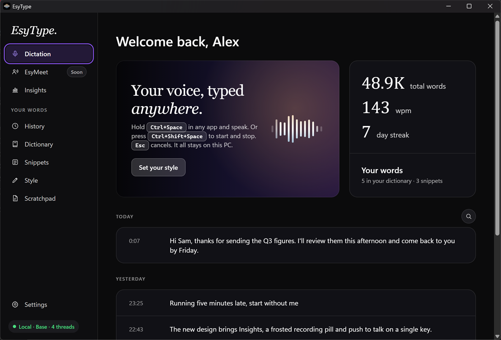
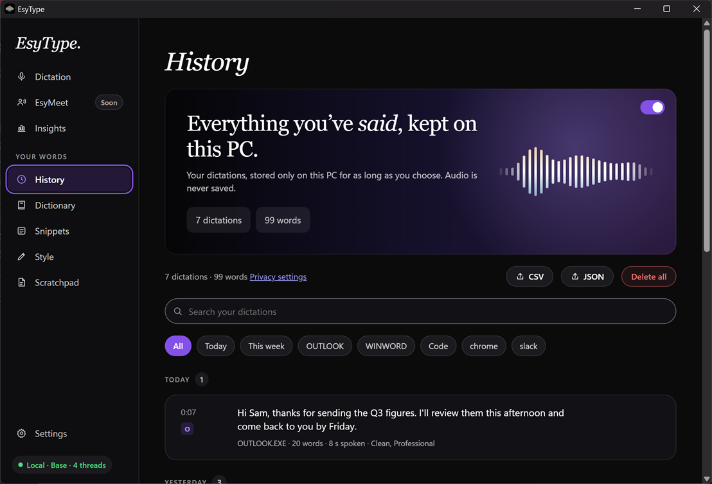
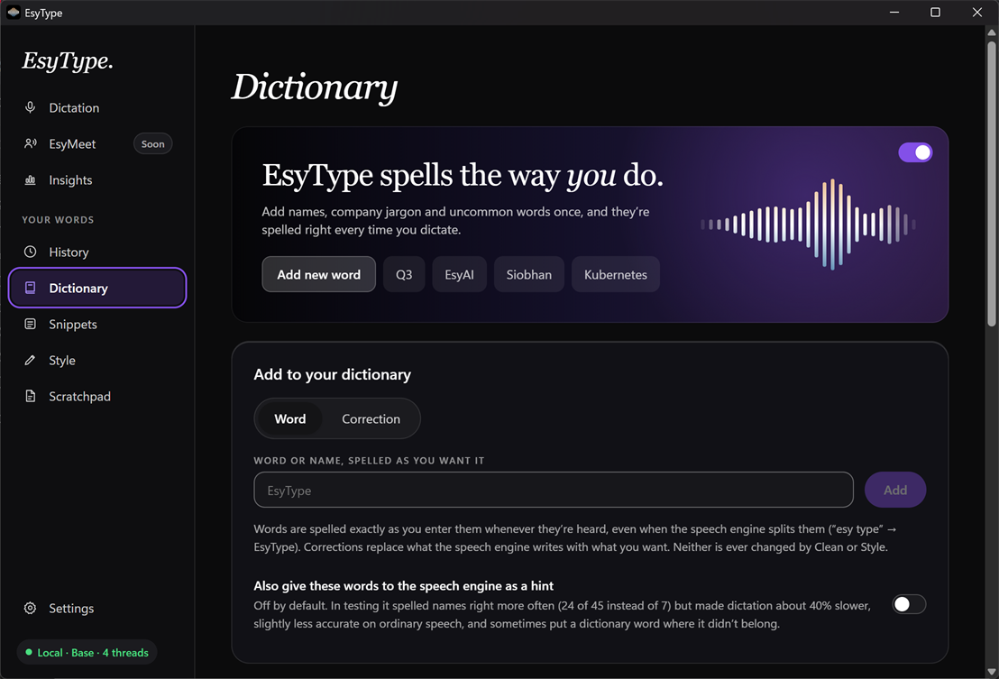
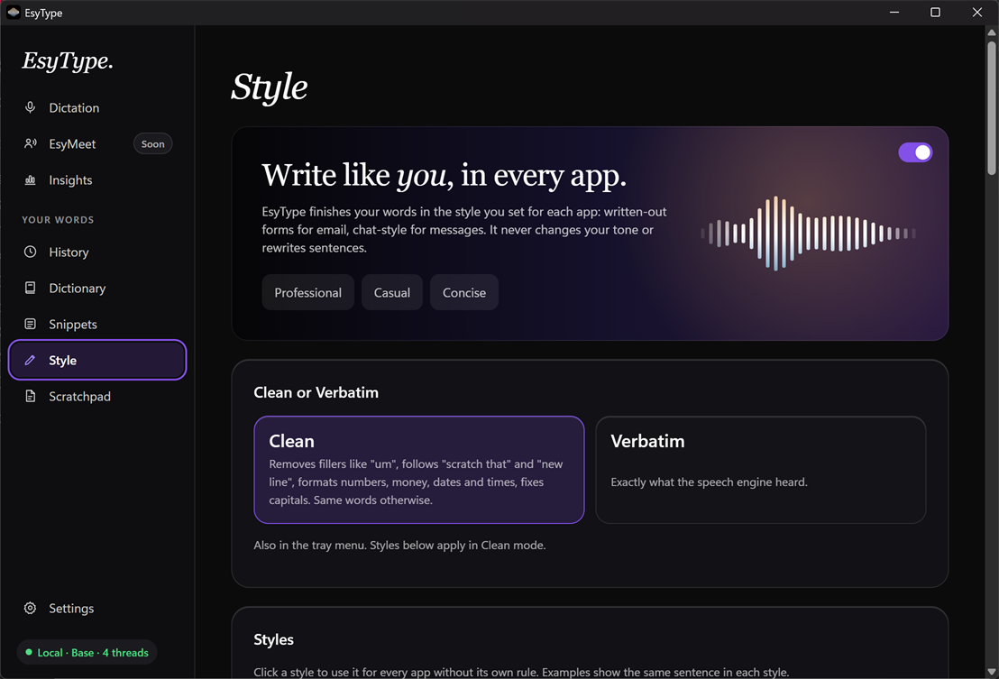
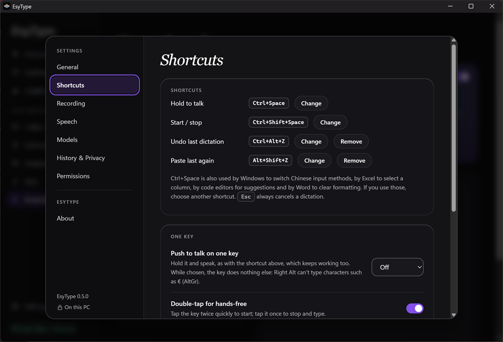

<p align="center"></p>

<h1 align="center">EsyType.</h1>

<p align="center"><b>Private voice dictation for Windows, by EsyAI.</b><br>
Hold a shortcut, speak, release. Your words are turned into text on your own PC and typed wherever your cursor is.<br>
No account, no cloud, no subscription, no usage limit.</p>

<p align="center"><a href="download/EsyType_0.3.0_x64-setup.exe"><b>⬇ Download EsyType 0.3.0 for Windows</b></a> (5.6 MB, 64-bit Windows 10 or 11)</p>



## Install

1. Download [`EsyType_0.3.0_x64-setup.exe`](download/EsyType_0.3.0_x64-setup.exe) (on the file's page, press the download button).
2. Run it. The installer is not code-signed yet, so Windows SmartScreen may say "Windows protected your PC": choose **More info**, then **Run anyway**.
3. EsyType installs for your Windows account only. No administrator rights are needed.
4. On first start, EsyType asks you to pick a speech model and downloads it once. After that it works fully offline.

SHA-256 of the installer: `5ffc7de35349bf3e1e214fb6554475c30f864dba2e8dd8b6c3152145f90efbee`

To remove it: Windows Settings → Apps → EsyType → Uninstall. Tick "Also delete my settings, History, notes and downloaded speech models" if you want nothing left behind.

## How it works

1. **Hold `Ctrl+Space`, speak, release.** Or press `Ctrl+Shift+Space` to start and again to stop. `Esc` cancels. You can change both shortcuts in Settings.
2. A small pill shows that EsyType is listening, then working.
3. Your speech is transcribed **on your PC** by [whisper.cpp](https://github.com/ggerganov/whisper.cpp). A voice-activity detector (Silero VAD) skips silence.
4. The text is tidied up and typed **into the window you started in**. If that window has gone, EsyType copies the text instead of typing it somewhere else.
5. Changed your mind? **Undo** for 60 seconds after a dictation, straight from the pill.

EsyType lives in the system tray and can start with Windows. English only for now.

## Features

| | |
|---|---|
| **Clean or Verbatim** | Clean removes "um", "uh" and stutters, writes numbers sensibly, fixes capitals, and understands voice commands such as "new line" and "scratch that". Verbatim types exactly what was heard. |
| **Dictionary** | Teach it names and words, or corrections ("princess" → "Princesa"). Import and export as CSV or JSON. |
| **Built-in product names** (new in 0.3.0) | "chat GPT" becomes ChatGPT, "Superbase" becomes Supabase, "Microsoft co-pilot" becomes Microsoft Copilot: 29 common product and tech names. Your own Dictionary always wins, and it can be switched off. |
| **Snippets** | Say a trigger phrase and get a saved block of text, for example your email signature with today's date. |
| **Style per app** | Standard, Professional, Formal or Casual, chosen for each program. Rules only: they never rewrite your sentences. |
| **History** | Every dictation, searchable, with the original transcription kept beside the edited text. Export to CSV or JSON. You choose how long it is kept, or turn it off. Audio is never saved. |
| **Scratchpad** | Notes for drafts, saved on your PC. |
| **Backup and restore** | One file holds your History, Dictionary, Snippets, notes and settings. |
| **Light, dark or follow Windows** (coming in the next release) | Settings > Appearance. Dialogs and notifications are frosted glass while Windows' Transparency effects are on. Every text meets WCAG AA contrast in both themes. |
| **Speech models** | Tiny (low-resource PCs), Base (balanced, the default) or Small (most accurate). EsyType says which ones fit your PC. Runs on an ordinary CPU; no graphics card needed. |

<table>
<tr><td></td><td></td></tr>
<tr><td align="center">History: every dictation, kept on your PC</td><td align="center">Dictionary and the built-in product names</td></tr>
<tr><td></td><td></td></tr>
<tr><td align="center">Style: how text is finished in each app</td><td align="center">Settings: speech model, microphone, shortcuts</td></tr>
</table>

## Privacy

- Audio and text **never leave your PC**. No account, no telemetry, no cloud transcription.
- The only internet use is the one-time download of the speech model you pick, from the whisper.cpp project's files on Hugging Face (a pinned version).
- Your data lives in `%LOCALAPPDATA%\EsyAI\EsyType`: settings, History, Dictionary, Snippets and notes. You can export it, back it up or delete it at any time.

## Accuracy

Measured on 220 test recordings with five voices, including two Indian English voices, using the Base model:

| | Before 0.3.0 | 0.3.0 |
|---|---|---|
| Product names spelled exactly right | 59% | **80%** |
| Word errors in ordinary sentences | 0.8% | 0.8% (not one ordinary clip changed) |
| Word errors on LibriSpeech (standard test audio) | 3.5% | 3.5% |
| Dictation time | unchanged | unchanged |

Full records: [docs/testing/2026-11-22-product-names.md](docs/testing/2026-11-22-product-names.md). Every release passes an automated end-to-end suite that dictates into real Word and Chrome windows. Results are in `docs/testing/`.

## Project status

Version **0.3.0**. Dictation, Clean mode, Dictionary, built-in product names, Snippets, Styles, Undo, History, Scratchpad, backup and the Windows installer are done and pass automated tests. Next: recognition accuracy on real voices, then optional AI enhancement (see [ROADMAP.md](ROADMAP.md)). Exactly what exists: [IMPLEMENTATION_STATUS.md](IMPLEMENTATION_STATUS.md).

## Documents

| Document | Contents |
|---|---|
| [docs/research/esyai-brand-analysis.md](docs/research/esyai-brand-analysis.md) | The EsyAI visual identity as observed on esyai.co.uk, with exact tokens and screenshots |
| [docs/research/wispr-flow-analysis.md](docs/research/wispr-flow-analysis.md) | Feature-by-feature study of the main competitor and how EsyType differs |
| [docs/research/open-source-evaluation.md](docs/research/open-source-evaluation.md) | Engines, libraries, models and licences, with the choices made |
| [docs/architecture/system-design.md](docs/architecture/system-design.md) | Processes, components, data flow, storage, privacy and security |
| [docs/design/esytype-design-system.md](docs/design/esytype-design-system.md) | Tokens, materials, components and the recording pill |
| [docs/decisions/README.md](docs/decisions/README.md) | Decision records, including the ones still open |
| [docs/testing/benchmark-plan.md](docs/testing/benchmark-plan.md) | What will be measured before any performance claim is made |
| [ROADMAP.md](ROADMAP.md) | Product direction and priorities |
| [TODO.md](TODO.md) | Next actions by phase |
| [CHANGELOG.md](CHANGELOG.md) | What changed and when |

## Built with

Tauri 2 · Rust · React and TypeScript · whisper.cpp · Silero VAD · SQLite (the optional llama.cpp helper is deferred with AI enhancement)

## Build and run

Requirements are in the section below. From the repository root:

```powershell
npm install
npx tauri build          # release build: src-tauri/target/release/esytype.exe
npx tauri dev            # development build with live reload
cd src-tauri; cargo test --release
```

`npx tauri build` also makes the Windows installer (`src-tauri/target/release/bundle/nsis/EsyType_<version>_x64-setup.exe`). Install or upgrade with it (on this PC into `D:\EsyAI\EsyType\app`, apart from every build folder); it keeps all settings and data. `scripts/install-local.ps1` is the older scripted copy, kept for reference. Installer tests use the separate "EsyType Test" product (`tauri.test.conf.json` and the `installer-test` feature) and `bench/e2e/installer-e2e.ps1`. Test builds (`--features e2e`) go to their own target folder (`CARGO_TARGET_DIR`) and are never installed.

`.cargo/config.toml` restores `/O2` for whisper.cpp; without it transcription is about 7 times slower.

## Development environment

Windows 10 or 11, 64-bit. Requires the Rust toolchain, Microsoft C++ Build Tools 2022 with the Clang component (`LIBCLANG_PATH` set), CMake and Node.js 24.

Development tooling and research evidence are kept outside this repository. Released installers are in [`download/`](download/).
