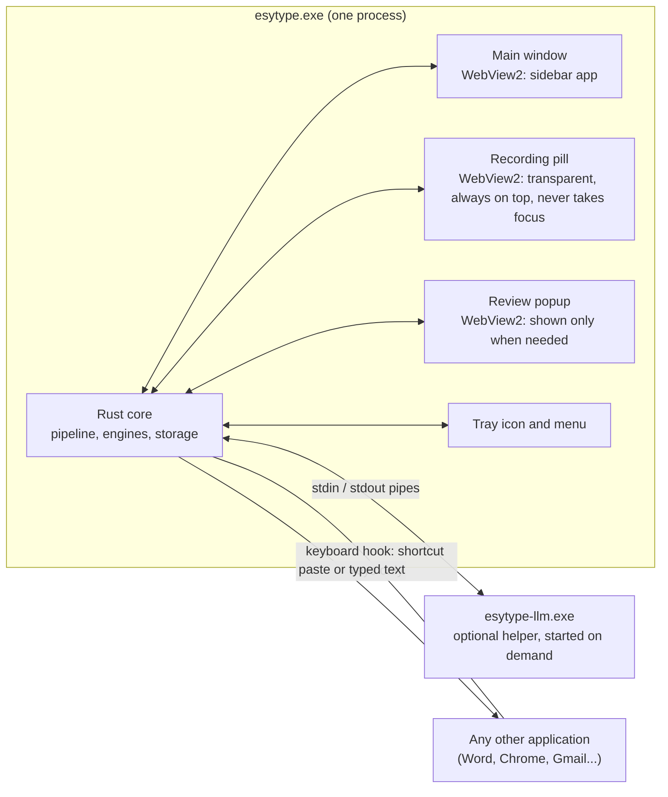
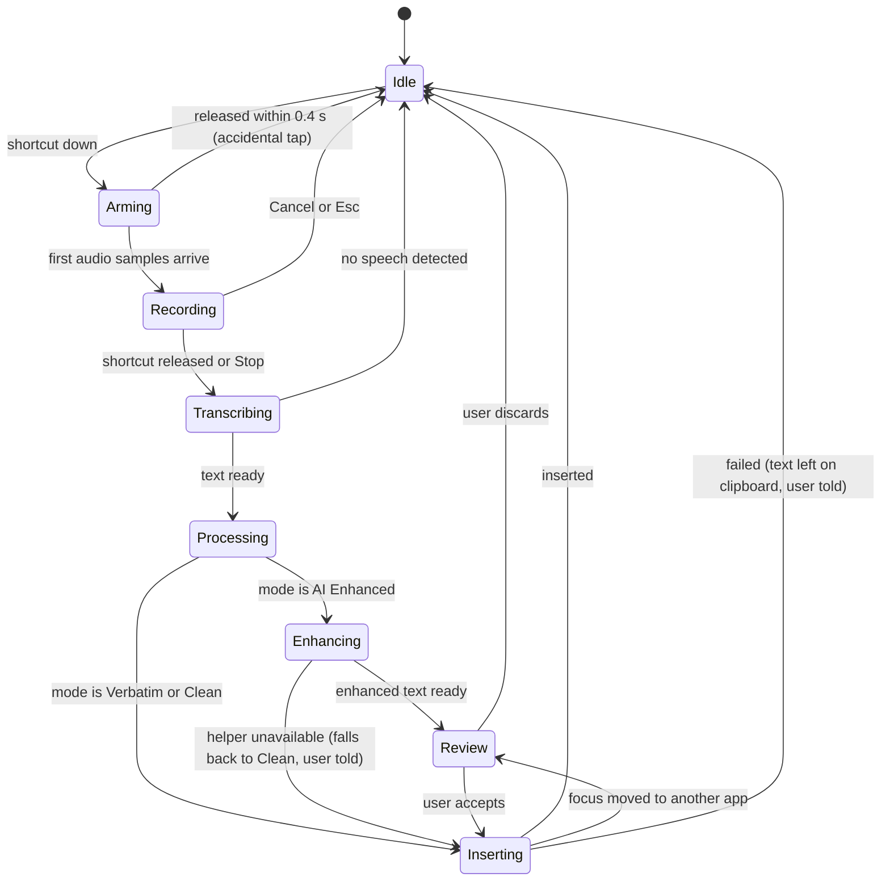
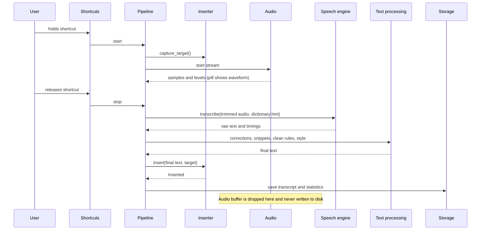

# EsyType system design

> **20 November 2026, owner decision:** AI enhancement is deferred (decision 0022). The optional language-model helper (`esytype-llm`), AI Enhanced mode and transforms described below are not being built or prepared; text processing is rule-based Clean mode and Verbatim. Those sections stay as a record of the earlier design.

**Status:** proposed, before any code
**Date:** 15 November 2026
**Inputs:** `docs/research/esyai-brand-analysis.md`, `docs/research/wispr-flow-analysis.md`, `docs/research/open-source-evaluation.md`

This document fixes the shape of the application. Anything described as a target or expectation is unmeasured and will be replaced by results from `docs/testing/`.

---

## 1. Design principles

1. **Dictation works without anything optional.** Speech recognition, formatting rules and text insertion never depend on the language model, the network or a GPU.
2. **Nothing leaves the device.** The only network requests are model downloads the user chose and update checks the user can turn off.
3. **Never type into the wrong place.** Text goes to the control that had focus when recording started, or the user is asked.
4. **Measured, not assumed.** Model recommendations come from a benchmark run on the user's own machine.
5. **Small and native.** One Rust core, the system WebView, no bundled browser or runtime.
6. **Replaceable engines.** Speech and clean-up sit behind interfaces so a better engine is an addition, not a rewrite.

---

## 2. Technology stack

| Layer | Choice | Reason in one line |
|---|---|---|
| Shell | Tauri 2.12 | Small installer, Rust core, Windows materials API |
| UI | React, TypeScript, Vite, Tailwind CSS | Same technology as the ESYAI site, so brand tokens carry over |
| Core language | Rust (MSVC target) | Direct Win32 access, no runtime, safe concurrency |
| Speech | whisper.cpp through `whisper-rs`, behind `SpeechEngine` | CPU-first, quantised models, no runtime |
| VAD | Silero VAD v6 (GGML) | 0.9 MB, loaded by whisper.cpp itself |
| Clean-up | llama.cpp in a separate helper executable | Isolation, memory release, no ggml clash, no network port |
| Storage | SQLite (`rusqlite`, bundled, FTS5) | One local file, full-text search |
| Windows APIs | `windows` crate | Keyboard hook, SendInput, clipboard, DXGI |
| Packaging | Tauri bundler, NSIS, per-user install | No administrator rights needed |

Alternatives considered and the reasons for rejecting them are in the open-source evaluation, section 6.

---

## 3. Process and window model



- **One main process.** WebView2 runs its own renderer processes; EsyType adds none of its own except the optional helper.
- **The pill never takes focus.** It is created as a non-activating, always-on-top tool window. Clicking Cancel or Stop on it does not move the caret out of the user's document. This is essential for insertion to work.
- **The main window can be closed** without stopping dictation; the app lives in the tray. A single-instance guard brings the existing window forward if the user starts EsyType again.
- **The helper is optional and disposable.** It is started when AI Enhanced or a transform is first used and stopped after an idle period, returning all its memory.

---

## 4. Components

The brief lists thirteen independent components. Each is a Rust module with a narrow public interface; they are grouped into five crates by what they depend on, so that pure logic can be unit-tested without Windows or a model, and so that slow native builds are not repeated.

| Crate | Component | Responsibility | Depends on |
|---|---|---|---|
| `esytype-core` (pure Rust, no OS calls) | **Pipeline** | Dictation state machine; orchestrates everything below through interfaces | none |
| | **Text processing** (7) | Clean mode rules: fillers, capitalisation, numbers, spoken lists, self-corrections; dictionary corrections; snippet expansion; style rules | none |
| | **Local storage** (10) | SQLite schema, migrations, queries for settings, history, dictionary, snippets, statistics | `rusqlite` |
| | **Model management** (11) | Manifest, download with resume, SHA-256 verification, install, delete, repair | `reqwest`, `sha2` |
| | **Settings** (13) | Typed settings with defaults and change notifications | storage |
| | **Hardware scoring** (12, logic half) | Turns hardware facts and benchmark results into green, amber or red per model | none |
| `esytype-platform` (Windows) | **Audio capture** (2) | WASAPI stream, 16 kHz mono conversion, level meter, pre-roll | `cpal`, `rubato` |
| | **Microphone management** (3) | Enumerate, select, follow default device, hot-plug events | `cpal`, `windows` |
| | **Global shortcuts** (4) | Low-level keyboard hook, chord state machine, conflict detection | `windows` |
| | **Text insertion** (9) | Capture target, verify focus, clipboard save and restore, paste, typed fallback | `windows` |
| | **Hardware detection** (12, probing half) | CPU, cores, instruction sets, RAM, GPU and VRAM, free storage, OS build | `sysinfo`, `windows` |
| `esytype-stt` | **Speech recognition** (5) and **VAD** (6) | `SpeechEngine` interface; whisper.cpp implementation; silence trimming and segmentation | `whisper-rs` |
| `esytype-llm` (separate executable) | **Optional AI clean-up** (8) | Loads a GGUF model, answers enhance and transform requests over pipes | `llama-cpp-2` |
| `esytype-app` (`src-tauri`) | **Desktop UI host** (1) | Windows, tray, commands and events between UI and core | `tauri` |
| `ui/` (TypeScript) | **Desktop UI** (1) | Pages, design system, recording pill, wizard | React |

**Independence rules**

- `esytype-core` never imports `esytype-platform`, `esytype-stt` or `esytype-llm`. It defines the interfaces; the app crate wires implementations in.
- The UI never touches the database or files directly. It calls typed commands.
- The helper executable shares only a small message-format module with the app.

### Key interfaces

```text
SpeechEngine
  load(model_path, options) -> handle
  transcribe(samples_16k_mono, {language, hint_text, threads}) -> {text, segments, timings}
  unload()
  capabilities() -> {languages, supports_hint, backend}

Enhancer            (implemented by a client that talks to esytype-llm.exe)
  available() -> bool
  enhance(text, style) -> text
  transform(text, instruction) -> text
  cancel()

Inserter
  capture_target() -> Target            (called when recording starts)
  insert(text, target) -> Inserted | TargetChanged | Blocked | Failed

AudioSource
  devices() -> [Device]
  start(device, on_samples, on_level) -> Stream
```

---

## 5. Dictation pipeline

### 5.1 States



The pill's five visible states map onto this: Ready (Arming), Recording, Processing (Transcribing, Processing, Enhancing), Inserting, Error.

### 5.2 Data flow for one dictation



### 5.3 Decisions inside the pipeline

| Decision | Choice | Why |
|---|---|---|
| When the microphone opens | On shortcut press, then kept warm for a short period after each dictation | An always-open microphone would keep the Windows microphone indicator lit permanently, which is wrong for a privacy product. Warm-keeping covers rapid successive dictations. |
| First-word loss | The "recording" cue is shown only when samples are really arriving | Opening a WASAPI stream takes a moment; the user should not speak into a closed microphone |
| Accidental taps | A press shorter than about 0.4 s with no speech is discarded silently | Prevents empty dictations |
| Audio retention | In memory only; discarded after transcription | Privacy. An optional "keep last recording for retry" setting holds one buffer in memory, never on disk. |
| Maximum length | Soft cap from available memory, with a warning before the cap; audio captured so far is always transcribed | No lost work |
| Model lifetime | Loaded on first use, kept in memory, unloaded after a configurable idle time; optional preload at start | Warm transcription is much faster than cold; idle unload frees memory |
| Silence | Bundled Silero VAD rejects recordings with no speech; speech recordings are passed through untrimmed (trimming cost accuracy in testing) | Prevents Whisper inventing text from silence |
| Dictionary | Terms passed as the engine's hint text, then corrections applied to the result | Two chances to get names right |
| Order of text steps | Snippets → Dictionary → Clean rules → style (built 20 Nov 2026) | Snippets match what was heard; snippet text and dictionary terms are protected from later steps |

---

## 6. Global shortcuts

- **Mechanism.** A low-level keyboard hook on its own thread. The hook callback does nothing except compare the key against the configured chords and post an event; it must return within Windows' hook timeout.
- **Privacy statement that the code must honour.** The hook examines only whether the keys of configured shortcuts are down. It never stores, logs or forwards keystrokes.
- **Chords supported.** Ordinary combinations (Ctrl + Shift + Space), modifier-only chords (Ctrl + Win), and single keys (for example a function key).
- **Gestures.** Hold to talk; press to toggle; double-tap the hold key to lock recording; Esc to cancel while recording.
- **Swallowing.** When a chord with a printable key matches, that key press is consumed so a stray space is not typed into the document.
- **Conflict handling.** At save time EsyType checks the chord against a list of known system and common-application shortcuts and warns. If registration fails, the user is told; nothing is accepted silently.
- **Known limit.** Windows does not deliver hooked keys from a window running as administrator to a normal process, and blocks simulated input going the other way. EsyType detects an elevated foreground window and says dictation cannot type there, offering the clipboard instead.

### The default push-to-talk key: a decision for the user

The brief specifies **Ctrl + Space** for push to talk and **Ctrl + Shift + Space** for toggle. Ctrl + Space has real conflicts on Windows:

| Where | What Ctrl + Space already does |
|---|---|
| Windows with a Chinese input method | Switches the input method on and off |
| Excel and Google Sheets | Selects the whole column |
| VS Code, Visual Studio, JetBrains IDEs | Opens code completion |
| Word | Clears character formatting |

A global shortcut on that chord takes it away from all of them. Two ways forward:

- **Option A, as specified:** Ctrl + Space, with a first-run check that warns if a conflicting app or input method is detected.
- **Option B, recommended:** a modifier-only chord for push to talk, **Ctrl + Win**, with double-tap to lock, and keep Ctrl + Shift + Space as the toggle. Holding two modifiers types nothing and collides with nothing; it is also what the leading competitor settled on.

**As built (21 Nov 2026):** shortcuts are registered with Windows' `RegisterHotKey` through the global-shortcut plugin, not the hook described above. That supports ordinary combinations and single function keys only; Option B needs the hook to be built first (see decision 0009).

---

## 7. Text insertion

### 7.1 Target capture and verification

When recording starts, the inserter records the foreground window, its process, and the focused control. Before inserting, it compares:

| Situation at insertion time | Action |
|---|---|
| Same window and control | Insert |
| Same application, different control | Insert, because the user moved the caret deliberately within the app |
| Different application | **Do not insert.** Show the review popup with the text, "Insert here" and "Copy" |
| EsyType's own window | Insert into EsyType (Scratchpad) or show the popup |
| Target closed | Show the popup |
| Target is elevated | Copy to clipboard and notify |

### 7.2 Insertion methods, in order

1. **Clipboard paste (default).**
   - Save the current clipboard contents in every memory-backed format, byte for byte, up to 64 MB (OLE bookkeeping and formats Windows regenerates are skipped). If anything cannot be copied exactly (drawing handles, private formats), type instead (method 2).
   - Add a leading space only when the character before the cursor needs one (a letter, digit or end punctuation; not after a space, line break, opening bracket or quote, or at the start). It is read through UI Automation, or with the standard text-box messages for plain Windows text boxes, in a separate thread with a 300 ms limit; only that one character is kept, never stored or logged; password fields are never read. If it cannot be read: a space only when directly continuing EsyType's own dictation in that window (within a minute, no key press or click in between), so a space is never doubled (built 20 Nov 2026).
   - Put a *promise* of the text on the clipboard (delayed rendering, owned by a hidden EsyType window), marked with the Windows formats that keep it out of clipboard history and cloud clipboard sync. Requests in the first 150 ms, before the paste key, are refused.
   - Wait until the user's shortcut modifiers are physically released, then send **Shift + Insert** (built 19 Nov 2026: a background program on the development PC read the clipboard on every Ctrl + V, which made failed pastes look successful).
   - Hand the text over only when the target asks for it. A reader identified as another program is refused. A reader that does not identify itself (no window, as Chrome and Electron apps read) is refused too when the target is a program known to identify itself (Word and the other Office apps, Notepad, and any program seen doing so since EsyType started); otherwise it is counted. That request is the confirmation: outcome `pasted`. No request within 3 s: outcome `failed`, and the pill offers Copy.
   - Keep the text on the clipboard after the first request for at least 1 s (25 times the target's response time, at most 3 s): Word reads it several times per paste, the last read up to ~220 ms after the first on an idle PC and later on a busy one. This hold runs on the paste's own thread, so the outcome, the pill, History and the next dictation do not wait; the next paste, EsyType's own copying and quitting wait for the restore (built 20 Nov 2026).
   - Then restore the saved clipboard, unless something else was copied meanwhile (that newer copy stays). When not confirmed, restore straight away.
2. **Simulated Unicode typing (fallback and per-app override).** Sends characters as Unicode key events in chunks. Line breaks are sent as Shift + Enter in applications known to submit on Enter, so a multi-line dictation does not send a half-finished chat message.
3. **Not inserted.** If the paste is not confirmed or typing is blocked, the user's clipboard is put back, the pill says "Not typed" with a Copy button, and History records `failed`. When focus moved to another window before insertion, nothing is typed and the text (without the spacing) is copied: `copied`.

### 7.3 Compatibility table

Kept as data, not code: a small list of process names with overrides (paste key, typing instead of paste, restore delay). Seeded during the testing phase from real results with Word, Chrome, Edge, Gmail, Google Docs, LinkedIn, ChatGPT, Notepad, Windows Terminal, VS Code, Slack and Teams, and editable by the user.

### 7.4 Recovery

- **Paste last transcript** shortcut re-inserts the most recent result (built: Alt+Shift+Z).
- **Undo last dictation** (built 20 Nov 2026): the app's own Ctrl+Z, once, only for the last dictation, within 60 s, in the same window, with no key press or click since (watched by keyboard/mouse hooks for that minute, times only). Pill button and Ctrl+Alt+Z. Restore original = Undo, then paste what was heard.
- Every dictation is in history regardless of whether insertion succeeded (unless history is off).

---

## 8. Speech recognition

- **Engine.** whisper.cpp on the CPU, on its own thread at below-normal priority so the app being typed into stays responsive.
- **Threads.** A setting: Automatic (default) or a fixed number. Automatic = one per physical core, at most logical processors minus one (4 on the development PC; half the logical processors if the core count cannot be read). Changed on 21 Nov 2026 from "logical minus one" (7 here): that was about 0.4 s faster idle but, with other programs busy, took a median 43 s for 10 s of speech, against 3.5 s for 4 threads, because whisper.cpp's threads wait for each other at every step (decision 0024, `docs/testing/2026-11-21-whisper-threads.md`).
- **Models.** Exactly three, one file each (section 10.3): Tiny, Base, Small.
- **Decoding defaults.** Greedy decoding, no carry-over context between dictations, language fixed when an English-only model is selected.
- **Warm-up.** The selected model is loaded at start-up and given one silent warm-up pass, so the first dictation is not the slowest.
- **Build requirement.** whisper.cpp must be compiled with `/O2`; the Rust `cmake` helper drops it by default (about 7 times slower). Set in `.cargo/config.toml` and checked in the release checklist.
- **Short-clip optimisation (off).** Shrinking whisper.cpp's 30 s encoder window cut short-clip time by 2 to 8 times, but made the model loop on 2 of 18 test clips. Not enabled until a repetition guard exists and passes a re-test.
- **Acceleration.** Not in the first release. GPU back ends need the Vulkan SDK or CUDA and have not been evaluated.

### Performance target

10 to 15 seconds of speech transcribed in 2 to 3 seconds, warm. **Measured on the development PC only** (`docs/testing/2026-11-17-stt-dev-pc.md`): Tiny meets it (1.2 to 1.4 s), Base meets it for 10 s and is at the limit for 15 s (2.6 and 3.0 s; 2.2 and 2.5 s with 8 threads), Small does not (about 8 s). No other hardware has been tested.

---

## 9. Optional AI clean-up

### 9.1 Three modes

| Mode | What runs | Needs the helper |
|---|---|---|
| **Verbatim** | Engine output with dictionary corrections and snippets only | No |
| **Clean** | Rules: remove fillers, fix capitalisation and spacing, format numbers, build lists from spoken numbering, resolve explicit self-corrections ("scratch that") | No |
| **AI Enhanced** | Clean, then the local language model improves wording for the chosen style | Yes |

### 9.2 Helper protocol

- Started on demand by the core; one request at a time; JSON lines over standard input and output.
- Messages: `load`, `enhance`, `transform`, `cancel`, `unload`, `status`.
- No sockets, no ports, no file access beyond the model path it is given.
- If the helper exits or exceeds a time limit, the request fails cleanly and the pipeline continues with the Clean text.

### 9.3 Meaning-preservation guards

Applied to every model output before it is shown:

1. Reject if the length ratio to the input is outside set bounds (a clean-up should not halve or double the text).
2. Reject if numbers, dates, names from the dictionary, or URLs present in the input are missing from the output.
3. Reject if the output looks like an answer or commentary instead of a rewrite.
4. On rejection, fall back to the Clean text and say so.

### 9.4 Review

AI Enhanced output is never inserted unseen. The review popup shows the enhanced text with changes highlighted, and offers Insert, Use original, Edit and Discard. A setting allows experienced users to auto-insert after a short countdown; it is off by default.

---

## 10. Model management

### 10.1 Manifest

A JSON manifest ships inside the application and is the only source of truth for what can be downloaded:

```json
{
  "id": "base",
  "kind": "speech",
  "engine": "whisper.cpp",
  "name": "Base",
  "tagline": "Balanced everyday dictation",
  "languages": "english",
  "license": "MIT",
  "files": [
    { "url": "https://huggingface.co/ggerganov/whisper.cpp/resolve/<pinned-commit>/ggml-base.en-q5_1.bin",
      "bytes": 59721011, "sha256": "<pinned>" }
  ],
  "measured": { "peak_ram_mb": 345, "ref_seconds_for_10s_clip": 2.56, "ref_probe_score": "<from the reference PC>" }
}
```

`measured` holds values from the benchmark, never estimates. They are the only input to the recommendation in section 10.3 besides the user's own hardware.

- URLs are pinned to a specific revision and each file has a SHA-256 hash, so a changed or tampered file is rejected.
- A manifest can be updated with an application update. It is never fetched from the network on its own.

### 10.2 Lifecycle

`Not installed → Downloading (resumable) → Verifying → Ready → (Corrupt → Repair) → Deleted`

- Downloads go to a `.partial` file with HTTP range resume, then are hashed, then renamed into place. A model is only ever visible to the engine after verification.
- On every load, file size is checked; a full hash check runs on demand ("Verify") or after a failed load. A corrupt model offers one-click repair.
- Models are stored once, in a folder the user can choose (default under the user's local application data; changeable to another drive). Updates and uninstall-with-keep-data never touch it.
- **Only the model the user selects is downloaded.** Nothing is pre-bundled and nothing is downloaded in the background. Another model can be downloaded, switched to or deleted later in Settings → Models, which shows the same sizes, requirements and status as the wizard.
- The speech model is mandatory; the clean-up model is optional and never required for dictation.

### 10.3 Speech model lineup and recommendation

**Lineup (from the 17 November 2026 benchmark):**

| Choice | Shown as | File | Download | Peak RAM (measured) |
|---|---|---|---|---|
| Tiny | Low-resource computers | `ggml-tiny.en-q5_1.bin` | 32 MB | 245 MB |
| Base | Balanced everyday dictation (default) | `ggml-base.en-q5_1.bin` | 60 MB | 345 MB |
| Small | Computers with more resources; also other languages | `ggml-small-q5_1.bin` | 190 MB | 601 MB |

**Facts collected by the wizard:** CPU name, logical processors, AVX2 support, total and available RAM, free space on the models drive.

**No hard-coded hardware table.** Only one machine has been measured, so the recommendation is computed from the user's own hardware against measured values:

1. **Fits?** Free storage ≥ download size + 50%. Available RAM ≥ the model's measured peak + EsyType's own measured footprint (to be measured once the app exists). A model that does not fit is shown red and cannot be selected.
2. **Fast enough?** The wizard runs a 1 to 2 second built-in CPU probe (no download). Predicted time for a 10 s clip = the model's reference time × (reference probe score ÷ this PC's score).
   - Green: predicted ≤ 3 s (the brief's target).
   - Amber: 3 to 6 s; selectable, with a warning that dictation will feel slow.
   - Red: over 6 s, or no AVX2 (untested); selectable only after an explicit warning.
3. **Recommend** the most accurate green model, preferring Base over Small unless Small is green. If nothing is green, recommend Tiny. Exactly one model carries the "Recommended" badge.
4. **Confirm after download.** A bundled 10 s sample is transcribed once. The measured time replaces the prediction on screen, and if it is amber or red EsyType offers the smaller model.

**Unproven assumption:** that one short CPU probe predicts whisper.cpp speed across different CPUs. Step 4 catches a wrong prediction for each user, and the probe must be validated on at least two other machines before release.

**Wizard and Settings display, per model:** name and tagline, download size, disk space needed, RAM needed, predicted (then measured) time for 10 s of speech, languages, and the green, amber or red status with its reason.

A machine that fails every check for AI clean-up still installs and runs basic dictation.

---

## 11. Local storage

### 11.1 Locations

| What | Where | Notes |
|---|---|---|
| Database | `%LOCALAPPDATA%\EsyAI\EsyType\esytype.db` | Single SQLite file |
| Logs | `%LOCALAPPDATA%\EsyAI\EsyType\logs\` | Rotated; never contain transcript text or audio |
| Models | `%LOCALAPPDATA%\EsyAI\EsyType\models\` by default | User-selectable |
| Application | Per-user install folder | Replaced by updates; holds no user data |

### 11.2 Schema outline

**Built so far (schema version 1, 19 November 2026):** `transcripts` only. Versions are tracked with SQLite's `PRAGMA user_version`, not a `schema_migrations` table; settings stay in `settings.json`. The rest of this table is the plan.

| Built column | Meaning |
|---|---|
| `created_at` | Milliseconds since 1970, UTC |
| `raw_text` | The engine's original transcript; NULL when "keep the original" is off |
| `final_text` | The text that was inserted |
| `edited_text` | The user's edit in History; NULL means unedited |
| `mode`, `language`, `model` | `verbatim` for now; `en`; `tiny`/`base`/`small` |
| `audio_ms`, `processing_ms` | Speech length and transcription time |
| `outcome` | `pasted`, `typed`, `copied` (focus moved) or `failed` |
| `app` | Executable file name only, e.g. `WINWORD.EXE`; NULL when app tracking is off |
| `word_count` | Words in `final_text` |

**Migrations.** Forward-only, one transaction per version. Before upgrading an existing database a copy is made (`esytype.db.bak-vN`) and deleted once the upgrade succeeds, so no stale copy outlives retention or deletion. A database from a newer EsyType is left untouched and history is switched off for that run.

**Failure isolation.** The entry is written only after the text has been inserted and the pill has finished; any database error (corrupt, locked, newer, disk full) is logged and shown on the History page, and dictation carries on. A failed insertion is still saved, so the words are not lost.

| Table | Holds |
|---|---|
| `settings` | Key and JSON value |
| `transcripts` | Time, duration, raw text, final text, mode, model, target process name, word count, transcription time, whether inserted and how |
| `transcripts_fts` | Full-text index over final text |
| `dictionary` | Term, kind (word or correction), replacement, notes |
| `snippets` | Trigger, expansion, match mode |
| `app_rules` | Process name, style, insertion overrides |
| `transforms` | Built-in and custom instructions |
| `scratchpad_notes` | Title, body, timestamps |
| `daily_stats` | Date, words, dictations, speech seconds, processing seconds |
| `models` | Manifest id, path, state, verified hash, benchmark result |
| `schema_migrations` | Applied versions |

Statistics are kept in `daily_stats` so that clearing history does not erase Insights unless the user asks for that too.

### 11.3 What is deliberately not stored

- Audio.
- Window titles (they often contain document or recipient names). Only the process name is kept, and that can be turned off.
- Clipboard contents.
- Anything typed by the user outside EsyType.

### 11.4 Protection and deletion

- The data folder inherits the user profile's access control; no other standard user can read it.
- `secure_delete` is on, and the database is compacted after bulk deletes, so removed transcripts are overwritten rather than left in free pages.
- **Built (History, 19 Nov 2026):** history on/off (off writes nothing), keep 30 days, 90 days (default) or until deleted (expired entries are removed at start-up and after every dictation), record the program name on/off, keep the original transcription on/off (turning it off also removes originals already saved), edit, delete one entry, delete all (followed by `VACUUM` and a WAL checkpoint so the text is not left in the file).
- **Planned controls:** turn history off; auto-delete after N days; delete one entry; clear all history; clear statistics; delete a model; "Delete all EsyType data" which removes database, logs and models.
- **Honest limits.** File permissions protect against other users of the PC. Protection against someone with physical access to the disk comes from Windows device encryption or BitLocker, which EsyType recommends in its privacy page. No local scheme protects against malware already running as the user. Encrypting the database with SQLCipher, with the key held by Windows data protection, is recorded as a later hardening option (ADR 0006); it is not in the first release because it complicates the build and full-text search.

---

## 12. Privacy and security

### 12.1 Every network request the application can make

| Request | When | Destination | Can be disabled |
|---|---|---|---|
| Model download | Only when the user selects a model | `huggingface.co` and the storage hosts it redirects to (later an ESYAI mirror) | Not needed after install |
| Update check | On start and daily | An ESYAI update address, to be provided | Yes, in Settings |
| Update download | When the user accepts an update | Same | Yes |
| WebView2 runtime | Only by the installer, only on PCs that lack it | Microsoft | Offline installer variant bundles it |

There are no others. Specifically: no analytics, no crash upload, no licence check, no remote fonts (Barlow and Instrument Serif are bundled), no remote images or scripts.

This table is reproduced in the app under Settings → Data and Privacy and in `docs/` and must be updated in the same change as any code that adds a request.

### 12.2 Enforcement

- The web layer has a content security policy that allows only the application's own files. It cannot fetch from the internet.
- Network code exists in exactly two Rust modules (model downloads and the updater).
- The UI can call only the commands listed in the Tauri capability files; each command validates its input.
- The helper process has no network code.
- Updates are verified by signature before they are applied. The installer and executables are to be Authenticode-signed (certificate to be procured by ESYAI).
- Model files are verified by hash before use.
- A test in the release checklist runs a full dictation with the network adapter disabled.

---

## 13. User interface structure

| Window | Content |
|---|---|
| **Main** | Sidebar: Dictation, Notetaker, Insights, Dictionary, Snippets, Style, Transforms, Scratchpad, Settings, Help. Dictation is the dashboard: welcome, total words, average words per minute, recent history, selected model, engine status, "local processing" indicator, quick-start. |
| **First-run wizard** | Welcome, Hardware, Speech model, Optional AI clean-up, Installation, Finish (with microphone test and a practice box). Shown inside the main window. Resumable. |
| **Recording pill** | Cancel, waveform, Stop; duration; state. Draggable; position remembered per monitor; hidden when idle by default. |
| **Review popup** | Enhanced-text review, wrong-window recovery, and transform results. |

**Notetaker** is a static Coming Soon page with no controls. The architecture leaves room for it in three places: `AudioSource` can gain a system-audio implementation, `SpeechEngine` already accepts long audio in segments, and the schema can gain meeting tables without touching dictation.

**Theme.** One theme, the ESYAI dark glass theme, built entirely from tokens so that a light theme can be added later without touching components. See `docs/design/esytype-design-system.md`.

---

## 14. Packaging and updates

- **Installer.** NSIS, per-user, no administrator prompt. Creates Start menu and optional desktop shortcuts, registers an uninstaller, optionally starts with Windows.
- **Contents.** Application, helper executable, VAD model, fonts, licences. No speech or clean-up models.
- **Models.** Downloaded by the first-run wizard, not the installer, so progress, retry and verification use the same code as later model changes.
- **Uninstall.** Removes the application. Asks whether to also remove models, history and settings; the default is to keep them.
- **Updates.** Signed, applied by the updater plugin. An update replaces the application folder only. Database migrations run on first start after an update and are forward-only with a backup copy of the database taken first.

---

## 15. Repository layout

```text
EsyType/
  README.md  CHANGELOG.md  TODO.md  IMPLEMENTATION_STATUS.md
  docs/
    research/      brand, Wispr Flow, open-source evaluation, assets
    architecture/  this document
    design/        design system
    decisions/     one short record per significant decision
    testing/       benchmark plans and results
  crates/
    esytype-core/       pipeline, text, storage, models, settings, hardware scoring
    esytype-platform/   audio, microphone, shortcuts, insertion, hardware probing
    esytype-stt/        SpeechEngine and whisper.cpp implementation
    esytype-llm/        helper executable
  src-tauri/            application host
  ui/                   React application
  resources/            fonts, VAD model, model manifest, sample audio, licences
```

---

## 16. Risks and open questions

| Item | Kind | Next step |
|---|---|---|
| CPU-only speed target | Measured on one PC: Tiny and Base meet it, Small does not | Validate on other hardware; repetition guard for the shortened window |
| CPU probe predicts transcription speed | Unproven assumption | Validate on at least two other machines; post-download measurement catches errors |
| Default push-to-talk key | Decision for the user | Section 6 |
| Gemma licence | Decision for ESYAI | Open-source evaluation, section 5.2 |
| Update address and code-signing certificate | Needed from ESYAI before release | |
| Insertion into unusual targets | Risk | Compatibility table from real tests |
| Toolchain disk space on the dev PC | Blocker for the foundation phase | Install to D:, with approval |
| Wispr Flow screenshots | Missing input | Layout reference only; not blocking |
